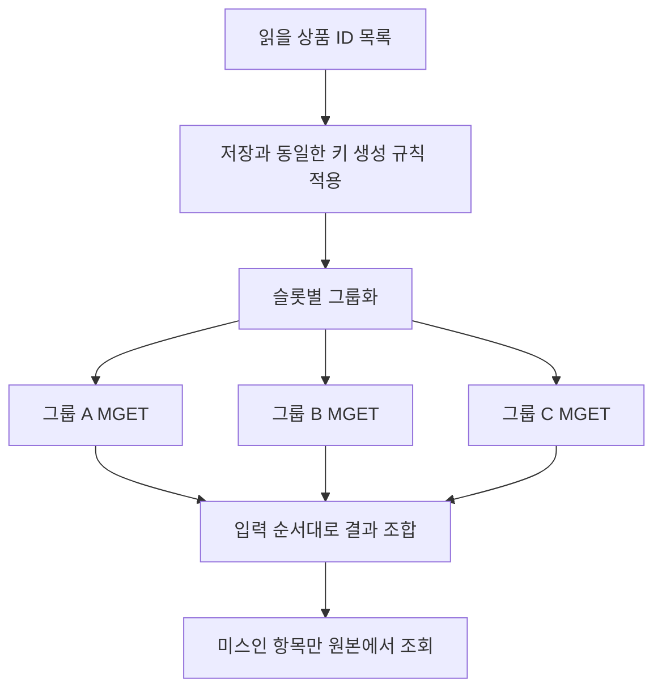

# Cache 2주차 — 많이 읽는 방법과 안전하게 변경하는 방법

> **오늘의 질문**: 가져올 데이터가 많다면? · 원자적 처리가 필요하다면?  
> **핵심 키워드**: Redis Cluster, 해시 슬롯, 해시 태그, MGET, Lettuce, Lua, 원자적 실행, 스크립트 캐시  

### 오늘 가져갈 네 문장

1. **슬롯은 Redis Cluster가 키를 어느 노드에 배치할지 관리하는 논리적 분류 단위다.** 키와 값은 실제 Redis 노드에 저장된다.
2. **같은 해시 태그는 관련 키를 같은 슬롯으로 모은다.** 태그를 적절한 수로 나누면 MGET 요청 분할을 줄이면서 분산도 확보할 수 있다.
3. **MGET·파이프라인은 통신 비용을 줄이는 도구이고, Lua는 짧은 조건 확인과 변경을 하나의 실행으로 묶는 도구다.** 모든 문제에 Lua가 필요한 것은 아니다.
4. **Lua의 원자적 실행은 자동 롤백, 재시도 중복 방지, DB까지의 트랜잭션을 보장하지 않는다.** 보장 범위를 구분해야 한다.

## 1주차에서 오늘로 연결하기

| 1주차 질문 | 앞서 다룬 관점 | 2주차로 이어지는 질문 |
| --- | --- | --- |
| 구조는 어떻게 진화했나? | 반복 조회를 줄이고, 로컬 캐시 등으로 원격 저장소의 부담을 줄임 | 그래도 원격 Redis를 많이 읽어야 한다면 요청을 어떻게 묶을까? |
| Remote–Local 정합성은? | 오래된 값의 허용 범위와 무효화 전파 | Redis 내부 변경이 원자적이어도 로컬 캐시가 즉시 갱신되는가? |
| 메모리가 크다면? | Bitmap·표현 형식 등으로 저장 비용을 줄임. Hotkey는 특정 키의 요청 집중 문제 | 데이터 크기를 줄이는 것과 조회 명령 수를 줄이는 것은 어떻게 다를까? |

---

## 가져올 데이터가 많다면?

### 1) 먼저 ‘많다’의 의미부터 나누기

| 실제 문제 | 주로 살펴볼 방법 | 해결하지 못하는 것 |
| --- | --- | --- |
| 어떤 키가 있는지 모르고 많은 키를 탐색해야 함 | SCAN | 값의 일괄 조회·원자적 스냅샷 |
| 이미 아는 여러 String 키의 값이 필요함 | MGET, Cluster의 슬롯별 분할 | 전송할 값의 총량 자체 |
| 독립적인 여러 명령의 응답을 매번 기다리는 비용이 큼 | 파이프라이닝 | 명령 묶음 전체의 원자성 |
| 한 Hash·Set·Sorted Set의 원소가 너무 많음 | HSCAN·SSCAN·ZSCAN, 필요한 범위 조회 | 단일 키를 여러 노드에 자동 분산 |
| 하나의 값·응답 자체가 너무 큼 | 필드·범위 제한, 데이터 분할, 직렬화 최적화 | 단순히 MGET으로 바꾸는 것만으로는 해결 안 됨 |
| 특정 키·노드에 부하가 몰림 | 키 배치, 로컬 캐시, 읽기 패턴 개선 | 배치 크기만 키운다고 해결 안 됨 |

### 2) 기본 구조: Redis, Cluster, 클라이언트

| 용어 | 쉬운 뜻 | 오늘의 역할 |
| --- | --- | --- |
| Redis | 데이터를 저장하고 명령을 실행하는 서버 | 키·값 저장과 GET·MGET·Lua 실행 |
| Redis Cluster | 데이터를 여러 Redis 노드로 나누어 운영하는 방식 | 슬롯을 기준으로 담당 노드를 결정 |
| Node | Redis 서버 인스턴스 | 실제 데이터를 보관하고 처리 |
| Slot | 키가 배정되는 논리적 분류 번호 | 키 배치·이동·다중 키 연산의 기준 |
| Hash tag | 슬롯 계산 기준을 지정하는 키 이름의 부분 | 관련 키를 같은 슬롯으로 묶음 |
| Lettuce | Java용 Redis 클라이언트 라이브러리 | 명령 전송, 응답 처리, Cluster 라우팅 등 |
| RedisTemplate | Spring Data Redis가 제공하는 작업 API | 애플리케이션에서 Redis 연산을 호출 |

```text
애플리케이션 코드
    ↓ Spring을 사용한다면 RedisTemplate 등
Redis 클라이언트(Lettuce 등)
    ↓ 네트워크
Redis Cluster의 해당 노드
    └─ 키와 값을 저장하고 명령을 실행
```

Redis Cluster는 AWS 서비스의 이름이 아니다. 직접 구축할 수도 있고 관리형 서비스로 운영할 수도 있다. Lettuce 역시 Redis 자체가 아니며, 슬롯은 Lettuce가 만든 개념이 아니다.

### 3) 키와 값, 그리고 슬롯

다음 데이터에서 **키 전체**는 `user:{1001}:name`이고 값은 `홍길동`이다.

```text
Key                         Value
user:{1001}:name             홍길동
user:{1001}:email            hong@example.com
user:{1002}:name             김민수
```

`user`를 테이블, `name`을 컬럼으로 Redis가 해석하는 것은 아니다. `:`를 포함한 전체 문자열이 하나의 키다. 다만 Cluster의 슬롯 계산에서는 유효한 `{...}`를 특별하게 해석한다.

일반적인 계산 규칙은 다음과 같다.

```text
해시 태그가 없을 때: slot = CRC16(키 전체) % 16384
해시 태그가 있을 때: slot = CRC16(태그 문자열) % 16384
```

Redis Cluster의 슬롯은 **0~16,383의 총 16,384개**다. 슬롯은 저장할 때 새로 생기는 것이 아니며, 고정 크기의 메모리 칸도 아니다. 슬롯 하나에 여러 키가 속하고, 노드 하나가 여러 슬롯을 담당한다.

같은 태그는 같은 슬롯으로 계산된다. 서로 다른 태그도 해시 충돌로 같은 슬롯에 들어갈 수 있고, 서로 다른 슬롯도 같은 노드에 있을 수 있다. 태그 `{1001}`은 **1001번 슬롯을 지정한다는 뜻이 아니다.**

해시 태그의 정확한 규칙은 첫 `{` 뒤의 첫 `}` 사이에 비어 있지 않은 내용이 있을 때 그 부분을 사용하는 것이다. 예를 들어 `a:{}:{x}`는 빈 첫 쌍 때문에 키 전체로 계산하고, `a:{x}:{y}`는 `x`를 사용한다. 실무에서는 중괄호 규칙을 단순하고 일관되게 유지하는 것이 좋다. [Redis Cluster 명세](https://redis.io/docs/latest/operate/oss_and_stack/reference/cluster-spec/)

**왜 키 → 노드로 바로 가지 않고 슬롯을 거칠까?**

슬롯이라는 중간 단위가 있으면 키 이름을 유지하면서 슬롯의 담당 노드를 바꾸는 리샤딩을 할 수 있다. 키 이름의 해시 태그를 바꾸는 일은 이와 다르다. 태그를 바꾸면 **키 자체가 달라지므로** 기존 데이터 이전과 읽기·쓰기 전환을 설계해야 한다.

`리샤딩`: 데이터베이스나 분산 스트리밍 시스템에서 샤드(Shard) 간의 데이터 분포나 샤드의 개수를 재조정하는 작업
`샤드`: 대규모 데이터베이스를 샤드라는 작은 단위로 쪼개어 여러 서버(노드)에 나누어 저장하는 수평 분할 기술

### 4) MGET: 여러 값을 한 명령으로 읽기

```redis
SET user:{1001}:name "홍길동"
SET user:{1001}:email "hong@example.com"
MGET user:{1001}:name user:{1001}:email user:{1001}:missing
```

MGET은 **String 값들을 읽는 명령**이다. Redis Hash의 여러 필드를 읽는 경우에는 HMGET을 구분해서 사용한다. 없는 키나 String이 아닌 값에 해당하는 MGET 결과는 nil이므로, nil을 업무상 캐시 미스로 처리할 때 자료형·직렬화 규칙도 일치해야 한다. [MGET 공식 문서](https://redis.io/docs/latest/commands/mget/)

Redis OSS Cluster에서 서버에 보내는 **단일 MGET의 키들은 같은 슬롯**에 있어야 한다. 같은 노드에 저장돼 있다는 조건만으로는 충분하지 않다. 여러 슬롯의 키를 직접 한 MGET에 넣으면 보통 `CROSSSLOT` 오류가 발생한다.

### 5) Lettuce를 거치면 호출 한 번이 여러 명령이 될 수 있다?

```text
애플리케이션: mget(키 100개) 호출 1번
                       ↓
Lettuce Advanced Cluster API: 키들을 슬롯별로 분류
                       ↓
       슬롯 A MGET / 슬롯 B MGET / 슬롯 C MGET / ...
                       ↓
               각 응답을 모아 결과 반환
```

여기서 설명하는 것은 해당 Advanced Cluster API의 기능이다. 모든 Redis 클라이언트나 모든 API가 자동으로 여러 슬롯의 MGET을 나누는 것은 아니다. Spring의 `multiGet`도 실제 드라이버, 연결 종류, 버전에 따라 경로를 확인해야 한다.

**명령 수와 네트워크 왕복 대기를 같은 숫자로 세지 않기**

100개의 명령이 병렬 전송될 수도 있다. 따라서 ‘100개 명령 = 100번 순차 RTT = 100배 느림’은 성립하지 않는다. 분할이 많으면 명령 처리·응답 조합·네트워크·큐잉 비용이 늘 수 있지만, 실제 지연은 노드별 부하와 실행 방식에 달려 있다.

### 6) 해시 태그로 MGET 분할을 줄이는 예시

**학습 상황**: 상품 ID 0~99의 String 캐시를 모두 조회한다. ID는 음수가 아닌 정수다.

```text
태그 종류가 많음                  10개 버킷 태그로 묶음
product:{item-0}:0                product:{bucket-0}:0
product:{item-1}:1                product:{bucket-1}:1
...                              ...
product:{item-10}:10              product:{bucket-0}:10
...                              ...
product:{item-99}:99              product:{bucket-9}:99
```

```java
// 예시 규칙일 뿐, 버킷 10개가 권장값이라는 뜻은 아니다.
String key = "product:{bucket-" + (id % 10) + "}:" + id;
```

`product:{bucket-0}:0`, `product:{bucket-0}:10`은 태그가 같아 같은 슬롯으로 간다. 버킷이 10종류이면 대상 슬롯 수는 **최대 10개**다. 충돌 때문에 더 적을 수 있고, 그 슬롯들이 10개의 서로 다른 노드에 배치된다는 보장은 없다.

| 조회 대상 키의 배치 | 슬롯별 MGET으로 나눌 때의 기본 명령 수 |
| --- | --- |
| 키 100개가 실제로 100개 슬롯에 배치 | 100개 |
| 태그 10종류로 그룹화 | 최대 10개 |
| 모든 키가 같은 태그 | 1개 |

재시도·리다이렉션·추가 배치 분할을 제외한 설명이다. MGET의 결과 데이터 총량은 그대로다.



**‘분배’라는 표현을 정확히 이해하기**

해시 태그 자체는 **모으는 기능**이다. 어떤 키들을 같은 슬롯으로 모을지 정하고, 여러 태그 그룹을 만들어 결과적으로 분산과 묶음 크기를 조절한다. 이미 존재하는 슬롯을 서버들에 균등 배치하는 작업을 해시 태그가 자동으로 수행하는 것은 아니다.

## 원자적 처리가 필요하다면?

### 1) 단일 명령이 원자적이어도 업무 흐름 전체는 아닐 수 있다

재고가 1개이고, 애플리케이션에서 `GET → 수량 확인 → DECR`를 별도로 실행한다고 하자.

| 순서 | 요청 A | 요청 B | Redis 재고 |
| --- | --- | --- | --- |
| 1 | GET → 1 | | 1 |
| 2 | | GET → 1 | 1 |
| 3 | 구매 가능 판단 후 DECR → 0 | | 0 |
| 4 | | 구매 가능 판단 후 DECR → -1 | -1 |

`DECR` 두 번은 각각 올바르게 실행됐다. 깨진 것은 **‘재고가 충분한 경우에만 차감한다’는 조건**이다. 이를 read–modify–write 경쟁 조건이라고 볼 수 있다.

```text
필요한 실행 단위:
[재고 읽기 → 충분한지 확인 → 충분하면 차감 → 결과 반환]
```

원자적으로 실행하면 A가 이 단위를 마친 뒤 B가 실행되어 재고 0을 보고 실패한다.

여기서 재고 예시는 **Redis가 변경 가능한 상태를 관리하는 상황**으로 잠시 확장한 것이다. DB가 원본인 단순 조회 캐시와 동일하게 취급하면 안 된다.

### 2) Lua는 무엇이고 어디서 실행되나?

Lua는 언어이며 Redis에는 Lua 실행기가 내장돼 있다. Java·Python 등의 애플리케이션이 스크립트와 인자를 보내면 **Redis 서버 안에서** 코드가 실행된다. 원자적 실행 보장은 Lua 언어 자체의 성질이 아니라 Redis의 실행 방식에서 나온다.

```text
애플리케이션에서 각각 처리          Redis 안에서 Lua로 처리
GET 요청 → 응답                   스크립트 요청
앱에서 조건 판단                    └─ GET → 조건 판단 → 변경
변경 요청 → 응답                  결과 응답
```

Lua는 Redis 데이터에 대한 짧은 조건부 연산에 적합하다. 파일 접근이나 외부 API 호출을 하는 일반 애플리케이션 코드 실행 환경으로 생각하면 안 된다. [Redis Lua API](https://redis.io/docs/latest/develop/programmability/lua-api/)

### 3) 무엇이 보장되고, 무엇이 남는가?

| 성질 | Lua가 제공하는가? | 의미 |
| --- | --- | --- |
| 실행 중 다른 클라이언트 명령의 중간 개입 방지 | 예 | 해당 Redis 서버에서 스크립트가 하나의 실행 단위로 처리됨 |
| 조건 확인 후 변경 | 구현 가능 | 스크립트 안에 조건과 변경을 함께 작성 |
| 에러 발생 시 이미 한 변경의 자동 취소 | 아니오 | 앞서 성공한 쓰기가 남을 수 있음 |
| 여러 Redis 슬롯 전체의 분산 트랜잭션 | 아니오 | 일반적인 Cluster 다중 키 스크립트는 같은 슬롯 필요 |
| DB 저장·결제 호출까지 원자적 처리 | 아니오 | Redis 바깥의 일관성은 별도 설계 |
| 같은 요청을 재시도해도 한 번만 적용 | 자동으로는 아니오 | 요청 ID·처리 결과 기록 등 멱등성 설계 필요 |
| 장애가 나도 성공한 변경이 반드시 보존 | 원자적 실행만으로는 아니오 | 복제·영속성·장애 전환 정책의 문제 |

Redis 공식 문서의 ‘atomic execution’은 다른 클라이언트가 스크립트 중간에 끼어들지 않는 실행을 뜻한다. 관계형 DB의 ACID에서 말하는 ‘전부 반영 또는 전부 취소’까지 같은 의미로 받아들이지 않는다. 단, DB 트랜잭션의 격리성도 항상 다른 작업을 전부 차단한다는 뜻은 아니며 격리 수준·락·쿼리 방식에 따라 달라진다. [Lua 실행 설명](https://redis.io/docs/latest/develop/programmability/eval-intro/), [Redis 트랜잭션](https://redis.io/docs/latest/develop/using-commands/transactions/)


### 4) 해시 태그와 Lua가 만나는 지점

재고와 예약 수량을 하나의 스크립트로 다루려면 다음처럼 관련 키를 같은 슬롯에 배치할 수 있다.

```text
product:{501}:stock     ─┐
                         ├─ 같은 태그 → 같은 슬롯 → 함께 처리 가능한 범위
product:{501}:reserved  ─┘
```

반면 상품 501과 702의 키는 같은 슬롯이라는 보장이 없다. 다른 슬롯이면 하나의 스크립트에서 두 상품을 함께 변경하는 일반적인 방식은 사용할 수 없다.

여기서 두 질문이 연결된다.

> 조회를 묶을 범위와 원자적으로 변경할 범위를 고려해 키 배치를 정한다. 함께 묶을수록 다중 키 연산이 쉬워지지만 특정 슬롯·노드에 부하가 모일 수 있다.

슬롯을 맞추는 것만으로 어떤 업무의 원자성이 자동으로 생기는 것은 아니다. 그 위에서 올바른 명령·스크립트를 실행해야 한다.

---

Lua는 Redis 안의 짧은 연산을 안전하게 묶는 도구이지, 주문 전체를 완성하는 트랜잭션 관리자가 아니다.

---

## 질문 카드

### 질문 1. `multiGet` 한 번인데 왜 Redis 명령은 여러 개일까?

- **시작 질문**: 키 100개를 한 번에 넘겼다. 서버 명령도 하나라고 볼 수 있을까?
- **핵심 설명**: Cluster 슬롯 제약과 클라이언트의 슬롯별 분할을 구분한다.
- **기대하는 논점**: 호출 횟수·슬롯 수·노드 수·병렬 요청 수는 서로 다르다.
- **꼬리 질문**: 키가 서로 다른 슬롯이지만 같은 노드에 있으면 단일 MGET으로 읽을 수 있을까?
- **정리**: Redis OSS Cluster에서는 같은 슬롯이어야 한다. 자동 분할은 클라이언트 기능이다.

### 질문 2. 모든 상품을 `{products}`로 묶으면 가장 빠를까?

- **시작 질문**: 명령 수가 1개가 되면 최적화가 끝났을까?
- **핵심 설명**: 요청 수는 줄지만 같은 슬롯과 담당 노드에 데이터·트래픽이 모인다.
- **기대하는 논점**: Hotkey/Hot slot, 응답 크기, p99, 수평 확장.
- **꼬리 질문**: 키 개수는 균등한데 트래픽이 불균등하면 무엇을 측정할까?
- **정리**: 키 개수 외에 요청 빈도·값 크기·노드별 부하를 본다.

### 질문 3. SCAN과 MGET 중 무엇을 써야 할까?

- **시작 질문**: ‘상품 100개의 ID를 알고 있다’와 ‘product로 시작하는 키를 전부 찾고 싶다’는 같은 문제일까?
- **핵심 설명**: 앞은 값 일괄 조회, 뒤는 키 탐색이다.
- **꼬리 질문**: 응답 바이트 자체가 너무 많으면 두 명령 중 하나를 고르는 것으로 충분할까?
- **정리**: 필요한 데이터 범위와 배치를 줄이고 데이터 모델도 살펴야 한다.

### 질문 4. DECR이 원자적인데 재고는 왜 음수가 될까?

- **시작 질문**: 재고가 1일 때 DECR을 두 번 하면 Redis가 잘못 동작한 것일까?
- **핵심 설명**: 개별 감소는 올바르지만 ‘0 이상’이라는 업무 조건을 검사하지 않는다.
- **기대하는 논점**: 단일 연산의 원자성과 read–check–write 전체의 원자성.
- **꼬리 질문**: `GET → 확인 → DECR`를 Pipeline에 넣으면 해결될까?
- **정리**: Pipeline은 조건부 로직 전체의 원자성을 제공하지 않는다.

### 질문 5. Lua에서 두 번째 명령이 실패하면 첫 번째도 취소될까?

- **시작 질문**: ‘원자적’이라는 말에서 우리는 어떤 보장을 기대했을까?
- **핵심 설명**: 중간 개입 방지와 자동 롤백을 분리한다.
- **기대하는 논점**: 검증을 먼저 하기, 쓰기 수 최소화, 복구 가능한 상태 모델.
- **꼬리 질문**: `MULTI/EXEC`로 바꾸면 관계형 DB처럼 자동 롤백될까?
- **정리**: Redis 트랜잭션에도 실행 중 오류의 자동 롤백은 없다.

### 질문 6. Lua 실행 후 타임아웃이면 재시도해도 될까?

- **시작 질문**: 응답을 못 받은 것과 서버가 실행하지 않은 것은 같은가?
- **핵심 설명**: 결과가 불명확할 수 있고, 원자적 연산도 두 번 실행하면 두 번 적용된다.
- **기대하는 논점**: 멱등 키, 처리 결과 조회, 보존 기간, 요청 ID와 인자 일치.
- **꼬리 질문**: 스크립트가 없어 `NOSCRIPT`가 난 상황과 같은 재시도인가?
- **정리**: NOSCRIPT는 그 요청의 코드가 실행되지 않은 경우지만 타임아웃은 결과 불명일 수 있다.

### 질문 7. 두 상품을 함께 구매하면 어떻게 될까?

- **시작 질문**: 상품별 태그 `{501}`, `{702}`를 사용하면서 두 상품 재고를 한 Lua로 차감할 수 있을까?
- **핵심 설명**: 같은 슬롯이라는 보장이 없으므로 일반적인 Cluster 스크립트로 묶을 수 없다.
- **기대하는 논점**: 원자적 처리 경계, 키 배치와 분산의 충돌, DB 트랜잭션·예약·보상.
- **정리**: 태그를 무조건 합치는 대신 업무에서 반드시 함께 보장할 범위를 먼저 정한다. 깊어지면 주차장으로 옮긴다.

### 질문 8. Lua로 바꾸면 로컬 캐시 정합성도 해결될까?

- **핵심 설명**: Redis 안의 실행과 다른 프로세스의 로컬 캐시 갱신은 별개다.
- **기대하는 논점**: 1주차의 TTL, 무효화 이벤트, stale 허용 범위.
- **정리**: 원자성·정합성·영속성·멱등성은 연결되지만 같은 보장이 아니다.

---

### 오늘의 세 줄 메모

- 해시 태그는 함께 조회·변경할 키들을 같은 슬롯으로 묶고, MGET 분할 수와 부하 분산 사이를 조절하는 설계 수단이다.
- Lua는 Redis 안의 짧은 조건 확인·변경을 중간 개입 없이 실행하지만, 자동 롤백과 DB까지의 트랜잭션을 제공하지 않는다.
- 최적화 전에 비용을 측정하고, 오류 복구 전에 Redis 데이터가 조회 복사본인지 업무 상태인지 확인한다.
